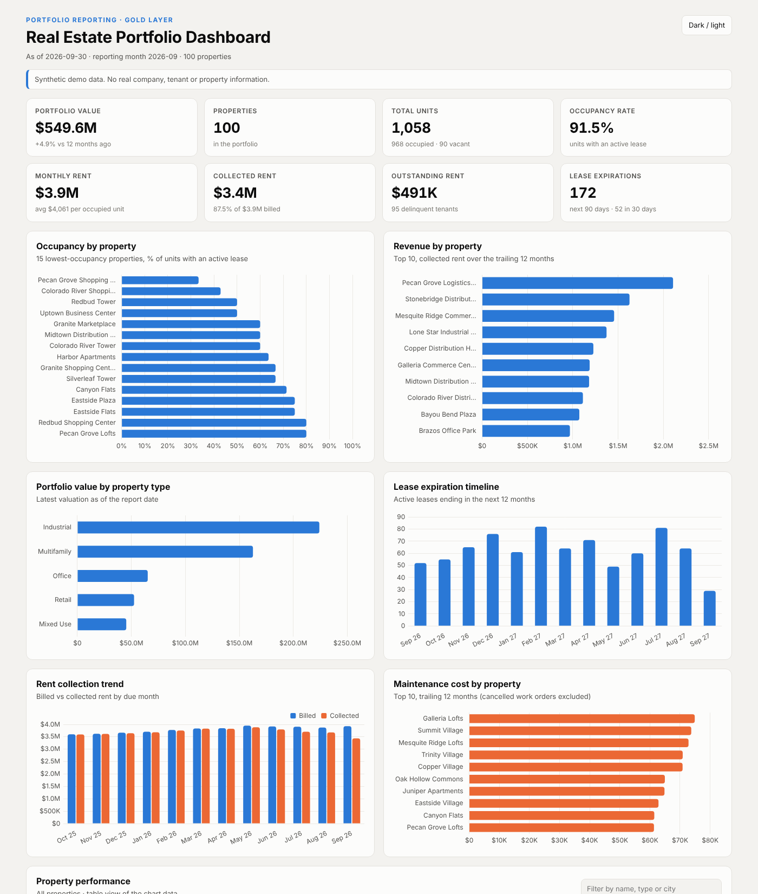
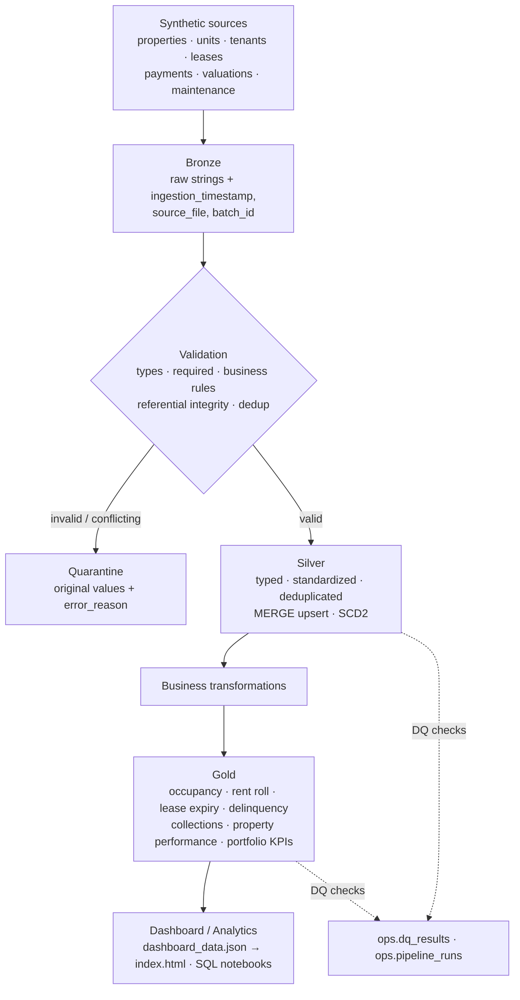
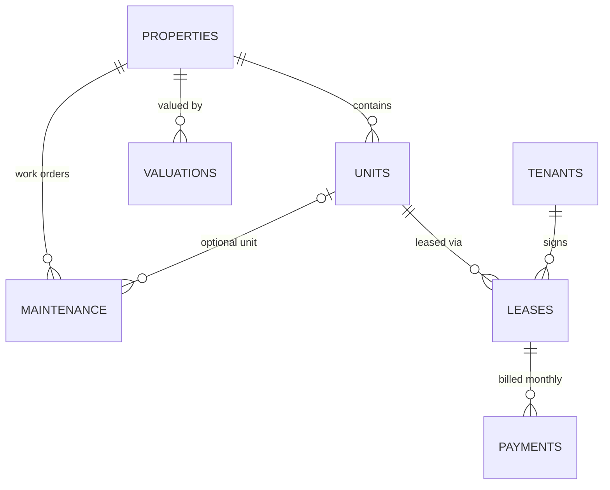
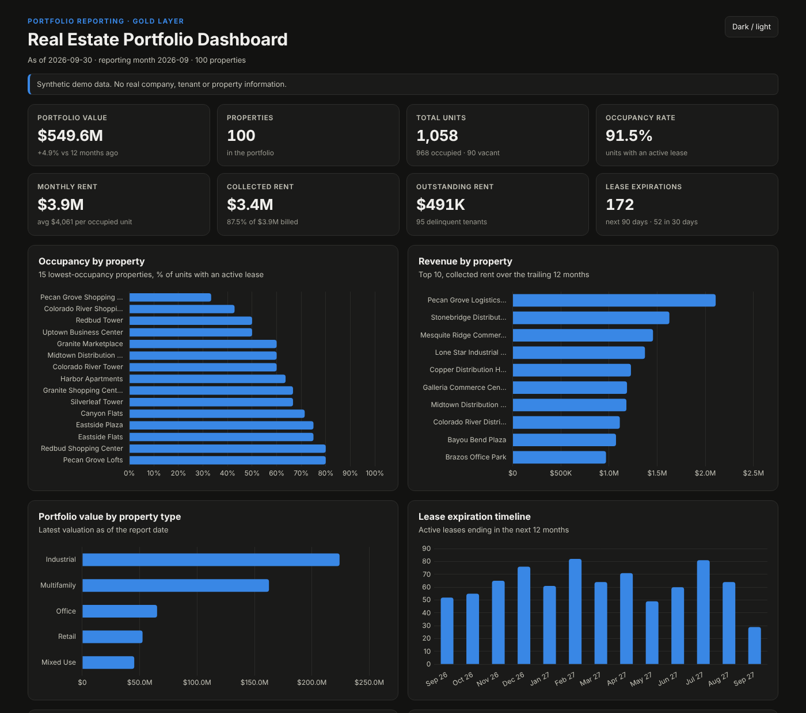
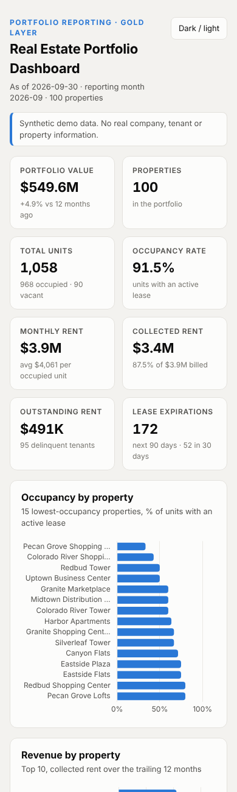

# Real Estate Lakehouse on Databricks

**A production-style demonstration of how I would design a real estate data platform on Databricks**:
PySpark + Delta Lake medallion architecture with validation and quarantine, deduplication,
idempotent incremental loads (Delta MERGE), SCD Type 2 history, business-ready Gold KPIs, automated
tests, CI and a lightweight executive dashboard.


> All data is **synthetic** (generated with Faker and a seeded generator). No real company, tenant or property data.



---

## 1. Business problem

A real estate asset manager runs **100 properties and 1,058 units** across Texas and the Sun Belt
(multifamily, office, retail, industrial, mixed use). Data arrives from separate systems: the property
register, unit inventory, tenant CRM, leasing, rent payments, appraisals and maintenance. Every month
someone stitches spreadsheets together to answer the same questions:

> How occupied are we? What rent is scheduled, what did we collect, what is still outstanding?
> Which leases expire soon? Who is delinquent? What is the portfolio worth and how did it change?
> Which properties perform best after maintenance costs?

The answers are slow, inconsistent, and bad source data (duplicates, broken references, impossible
dates) silently skews them.

## 2. Solution

A centralized **Databricks lakehouse** that:

- lands every source extract unchanged in **Bronze** (full audit trail),
- validates, standardizes and deduplicates into **Silver**, sending bad rows to **quarantine** with a
  reason instead of guessing a fix,
- loads new and changed records **incrementally and idempotently** with Delta MERGE,
- keeps **history** (SCD Type 2 tenants, valuation history),
- publishes **Gold** tables with documented KPI definitions, checked by automated data-quality rules,
- feeds a **management dashboard** and SQL analysis notebooks.

## 3. Architecture



More detail (write patterns, demo vs production, Unity Catalog): [docs/architecture.md](docs/architecture.md)

## 4. Technology stack

| Area | Technology |
|---|---|
| Processing | **PySpark 4** (DataFrame API only, serverless-compatible) |
| Storage | **Delta Lake** (MERGE, replaceWhere, time travel) |
| Platform | **Databricks** (Free Edition / serverless, Unity Catalog, Volumes, notebooks); runs locally with open-source Spark |
| Config | YAML (`config/config.yaml`), no hard-coded paths |
| Quality | Row-level validation + quarantine, post-load DQ suites, run logging to Delta |
| Testing | **pytest** (unit, data quality, integration), pytest-cov, ruff |
| CI | **GitHub Actions**, no Databricks credentials required |
| Dashboard | Static HTML + CSS + **Chart.js** (vendored), reads exported JSON |

## 5. Data model



| Source | Rows (batch_001 + batch_002) | Key |
|---|---|---|
| properties | 102 (100 unique) | `property_id` |
| units | 1,061 | `unit_id` |
| tenants | 1,503 + 39 | `tenant_id` |
| leases | 1,668 + 36 | `lease_id` |
| payments | 14,618 lines + 66 | `payment_id` |
| valuations | 592 + 100 | `valuation_id` |
| maintenance | 1,483 | `maintenance_id` |

Every column, type, rule and example: [docs/data_dictionary.md](docs/data_dictionary.md).
The injected data problems are listed in [data/raw/DATA_ISSUES.md](data/raw/DATA_ISSUES.md).

## 6. Bronze / Silver / Gold

| Layer | What happens | Tables |
|---|---|---|
| **Bronze** | CSV read with an all-string schema, values preserved; `ingestion_timestamp`, `source_file`, `batch_id` added; malformed rows → `quarantine.bronze_rejects`; missing/empty files and missing columns stop the load. | `bronze.<entity>` (7) |
| **Silver** | ANSI-safe casts, standardization (state codes, emails, status case), business rules, referential integrity, dedup, quarantine, Delta MERGE; tenants as **SCD2**; valuation history with effective dates. | `silver.<entity>` (7) + `silver.property_value_history`, `quarantine.<entity>` |
| **Gold** | Business models rebuilt from Silver with documented formulas. | `occupancy`, `rent_roll`, `lease_expiry`, `tenant_delinquency`, `maintenance_summary`, `collection_trend`, `property_performance`, `portfolio_summary` |

Locally tables are Delta folders (`lakehouse/<layer>/<table>`); on Databricks they are Unity Catalog
tables `<catalog>.<layer>.<table>` (production: `real_estate.silver.leases`).

## 7. Data quality strategy

**Never silently fix data.** Each rule that fails adds a reason; the row goes to quarantine with its
original values, `error_reason` and `validation_timestamp`.

| Check | Examples caught in the sample data |
|---|---|
| Types / dates | `2024-02-30`, `09/01/2026`, `approx 900` sq ft |
| Required fields | missing keys or dates |
| Business rules | lease ends before it starts, negative rent, negative payment, zero valuation, completed before requested |
| Referential integrity | unit → unknown property, lease → unknown tenant/unit, payment → unknown lease, **unit belongs to a different property** |
| Duplicates | exact re-sends (kept once), conflicting duplicates (all versions quarantined) |
| Malformed rows | wrong number of CSV fields |
| Batch threshold | a batch with > 10% quarantined rows is rejected and Silver is left untouched |
| Post-load DQ suites | PK uniqueness, not-null, FK, ranges (occupancy/collection 0–100), one current SCD2 version; results in `ops.dq_results`, failures stop the pipeline |

On the sample data: 13 lease, 9 payment, 6 maintenance, 3 unit, 3 valuation, 2 tenant rows quarantined
and 2 malformed payment rows rejected in batch_001; 25 exact duplicate payments, 2 duplicate leases and
2 duplicate properties removed. Deduplication strategy: [docs/architecture.md#deduplication](docs/architecture.md#deduplication).

## 8. Incremental processing

- Each extract is a **batch** (`batch_001` initial, `batch_002` incremental). Bronze and Silver process only that batch.
- Silver uses **Delta MERGE** keyed on the business key; rows update only when their `row_hash` changed.
- **Idempotent**: re-running any batch leaves every table unchanged (verified in tests and on the full dataset).
- `batch_002` contains 20 late-reported move-ins (+ new tenants), 10 lease renewals, 30 late September
  payments, 15 tenant contact changes, Q3 valuations, unchanged re-sends and invalid rows.

**SCD Type 2 (tenants)**: `effective_from`, `effective_to` (`9999-12-31` = open), `is_current`. A contact
change closes the old version the day before the batch's effective date and inserts a new current
version, using the staged-union MERGE pattern. Details: [docs/architecture.md#scd-type-2-tenants](docs/architecture.md#scd-type-2-tenants).

## 9. Business KPIs

As of **2026-09-30** (after both batches, synthetic data):

| KPI | Value | KPI | Value |
|---|---|---|---|
| Total properties | **100** | Monthly scheduled rent | **$3.93M** |
| Total units | **1,058** | Collected rent (Sep 2026) | **$3.44M** |
| Occupied / vacant units | **968 / 90** | Outstanding rent (Sep 2026) | **$0.49M** |
| Occupancy rate | **91.5%** | Collection rate | **87.5%** |
| Portfolio valuation | **$549.6M** | Property value growth (12m) | **+4.9%** |
| Leases expiring in 30 / 90 days | **52 / 172** | Delinquent tenants | **95** ($0.99M) |
| Revenue (TTM collected rent) | **$44.5M** | Maintenance cost (TTM) | **$2.9M** |
| Avg rent per occupied unit | **$4,061** (all asset types) | Net rent after maintenance (TTM) | **$41.5M** |
| Estimated NOI (TTM)* | **$28.2M** | Revenue / maintenance by property | `gold.property_performance` |

\* **Estimated NOI** = TTM collected rent × (1 − 30% assumed operating expenses) − TTM maintenance.
It is assumption-based and labeled as such, because the dataset has no taxes, insurance, utilities or
payroll. Every formula is in [docs/architecture.md#kpi-definitions](docs/architecture.md#kpi-definitions).

## 10. Dashboard

`dashboard/index.html` is a static executive dashboard (Chart.js, no build step). Open it directly in a
browser: data loads from `dashboard/data/dashboard_data.js` (a copy of `dashboard_data.json`), so it
works from `file://`. KPI cards, occupancy, revenue, value by type, lease expiry timeline, collection
trend, maintenance cost, a searchable property table and the delinquency list. Responsive, with dark mode.

| Light | Dark | Mobile |
|---|---|---|
|  |  |  |

Flow: `Gold Delta tables → src/dashboard/export_dashboard.py → dashboard_data.json → index.html`

## 11. Testing strategy

60 pytest tests in three groups (details: [docs/testing.md](docs/testing.md)):

| Group | Covers |
|---|---|
| **Unit** (`tests/unit`) | occupancy, collection rate, rent roll, lease expiry, delinquency, value growth, safe casting, validation reasons, deduplication, SCD2, payment status, config, file checks, idempotent writes, run logging |
| **Data quality** (`tests/data_quality`) | PK uniqueness, required columns, property/unit/lease relationships, lease dates, rent and payment ≥ 0, valuation > 0, rates within 0–100 |
| **Integration** (`tests/integration`) | Bronze → Silver → Gold on hand-checked fixtures: valid rows reach Gold, invalid rows quarantined with the right reason, duplicates don't multiply, reruns idempotent, incremental MERGE + SCD2, Gold KPIs equal hand-calculated values, threshold stops a bad batch, dashboard export |

```bash
pytest --cov=src tests/
```

Latest local run (Python 3.13, PySpark 4.0.1, Delta 4.0.0): **60 passed in 8 min 7 s, 91% line coverage** (`src/pipeline.py` CLI paths are the main gap at 46%).

## 12. How to run locally

Requirements: Python 3.10+ and **Java 17+** (for Spark). Delta Lake jars download automatically on first run.

```bash
git clone https://github.com/M-Aadhi/real-estate-databricks-lakehouse.git
cd real-estate-databricks-lakehouse
python -m venv .venv && source .venv/bin/activate
pip install -r requirements.txt

python scripts/generate_sample_data.py      # optional: data/raw is already committed (seed 42)
python -m src.pipeline --all                # batch_001 + batch_002 → Bronze, Silver, Gold, dashboard JSON
python scripts/show_results.py              # run log, quarantine reasons, KPI summary
open dashboard/index.html                   # or double-click it

# step by step
python -m src.pipeline --batch batch_001 --layers bronze,silver
python -m src.pipeline --batch batch_002 --layers bronze,silver
python -m src.pipeline --layers gold
python -m src.bronze.ingest_leases --batch batch_001       # single entity
```

## 13. How to run in Databricks

1. Databricks **Free Edition** → **Workspace → Create → Git folder** → this repository URL.
2. Run `notebooks/01_bronze_ingestion` … `05_incremental_merge_demo` on serverless compute
   (`catalog` widget defaults to `workspace`).
3. Notebook 01 creates the schemas and a Unity Catalog **Volume** and copies `data/raw` into it.

Full guide, what runs where, and troubleshooting: [docs/databricks_setup.md](docs/databricks_setup.md).

> **Honesty note:** the code was written for serverless compute (no RDDs, caching, DBFS or unsupported
> Spark configs) and the full pipeline was executed and tested locally with open-source PySpark +
> Delta Lake. The notebooks have **not yet been executed in a Databricks workspace** for this release.

## 14. Example output

```
silver.payments   batch_001  read 14,616  written 14,582  rejected 9   (25 exact duplicates removed)
silver.leases     batch_001  read  1,668  written  1,653  rejected 13  (conflicting_duplicate_key 4,
                                                                         lease_end_before_start 4, ...)
silver.leases     batch_002  read     36  written     35  rejected 1   (unknown_unit_id)
silver.tenants    after batch_002: 1,533 versions, 1,518 current (15 SCD2 changes)
DQ PASS  silver.payments  unique(payment_id)  failed_rows=0     ... 25 checks, all passing
```

Full captured output: [docs/example_output.md](docs/example_output.md).

## 15. Future production improvements

- **Auto Loader** (`cloudFiles`, `availableNow`) and Lakeflow Connect instead of batch folders.
- **Lakeflow Jobs / Declarative Pipelines** deployed with **Declarative Automation Bundles** (dev/prod targets).
- `real_estate` catalog with **Unity Catalog grants**, column masks on tenant PII, row filters per fund/region.
- Incremental Gold (MERGE / materialized views) and **Metric Views** for governed KPIs.
- **AI/BI dashboard + Genie space** on Gold for self-service questions.
- Lakehouse Monitoring and alerting on DQ results; real operating expenses for a true NOI.

## 16. Repository structure

```
real-estate-databricks-lakehouse/
├── config/config.yaml              # environments, batches, reporting dates, DQ thresholds, assumptions
├── data/raw/                       # batch_001 CSVs + incremental/batch_002, DATA_ISSUES.md
├── scripts/
│   ├── generate_sample_data.py     # seeded synthetic data with injected issues
│   ├── show_results.py             # run log, quarantine, KPI summary
│   ├── generate_data_dictionary.py # docs/data_dictionary.md from registry + tables
│   └── build_notebooks.py          # generates notebooks/
├── src/
│   ├── common/                     # config, spark, storage (Delta/UC), schemas, validation, data_quality, logging
│   ├── bronze/                     # ingest.py + ingest_<entity>.py
│   ├── silver/                     # base.py, dedup.py, scd2.py, transform_<entity>.py
│   ├── gold/                       # metrics.py (KPI logic) + one module per Gold table
│   ├── dashboard/export_dashboard.py
│   └── pipeline.py                 # orchestrator / CLI
├── tests/                          # unit/, data_quality/, integration/, fixtures/
├── dashboard/                      # index.html, style.css, app.js, vendor/chart.umd.js, data/
├── notebooks/                      # 01–05 Databricks notebooks
├── docs/                           # architecture, data dictionary, testing, Databricks setup, images
└── .github/workflows/test.yml      # CI: lint + pytest + coverage
```

## 17. Security

No credentials in the repository. `.env.example` documents optional variables; `.env`, tokens and
`.databrickscfg` are git-ignored. CI needs no secrets.

---

*Built as a portfolio project by **Marimuthu R**, Data Lead (Databricks · Power BI · data warehousing).
[LinkedIn](https://www.linkedin.com/in/zeb-mari) · [GitHub](https://github.com/M-Aadhi)*
