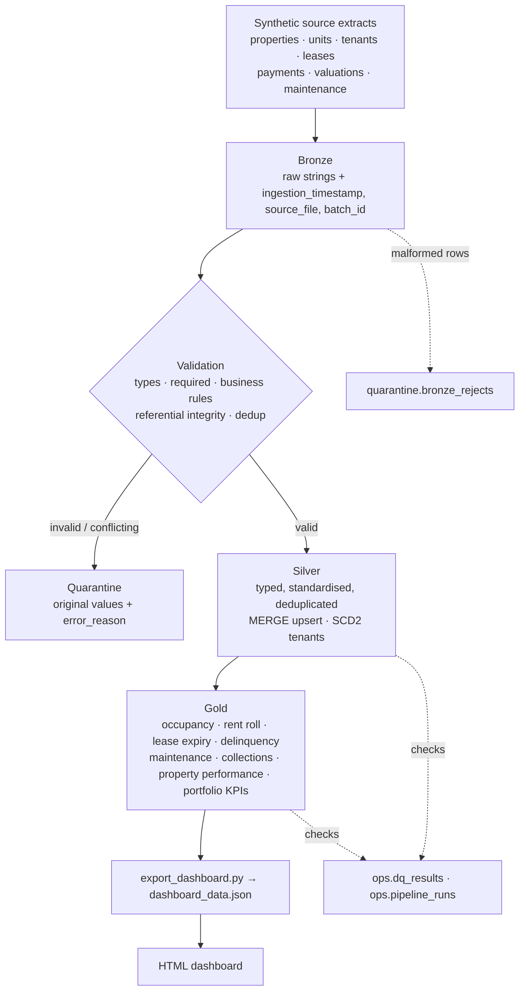

# Architecture

## Flow



## Layers

| Layer | Purpose | Write pattern | Idempotency |
|---|---|---|---|
| **Bronze** | Land each source file as-is. All columns STRING, plus `ingestion_timestamp`, `source_file`, `batch_id`. No business logic. | `replaceWhere batch_id = …` | Re-running a batch replaces only that batch |
| **Quarantine** | Rows that fail validation, with original values, `error_reason`, `validation_timestamp`. Malformed CSV rows in `bronze_rejects`. | `replaceWhere batch_id = …` | Same |
| **Silver** | Typed, standardised, validated, deduplicated, one row per business key (tenants: one row per version). | Delta `MERGE` on the primary key; SCD2 MERGE for tenants | MERGE updates only when `row_hash` changed |
| **Gold** | Business tables for reporting. | Full refresh from Silver | Deterministic |
| **Ops** | `pipeline_runs` (one row per step) and `dq_results`. | Append | Log tables |

## Validation (Silver)

Applied in order, every failure adds a reason (rows can have several):

1. **Required columns** present (`missing_required:<col>`).
2. **Types** parse with ANSI-safe `try_cast` / `try_to_timestamp`; a non-empty value that does not
   parse becomes `invalid_<type>:<col>`. Nothing is guessed (`2024-02-30` is rejected, not rolled over).
3. **Business rules** per entity, e.g. `lease_end_before_start`, `negative_monthly_rent`,
   `negative_amount_paid`, `property_value_not_positive`, `completion_before_request`.
4. **Referential integrity** against current Silver parents: `unknown_property_id`, `unknown_tenant_id`,
   `unknown_unit_id`, `unknown_lease_id`, plus `unit_property_mismatch` (unit belongs to another property).
   Entities load in dependency order: properties → units → tenants → leases → payments → valuations → maintenance.
5. **Threshold**: if more than `data_quality.max_quarantine_pct` (10%) of a batch is quarantined, the
   load stops with `DataQualityThresholdError` and Silver is not changed. Quarantine is still written for review.

Standardisation is limited to safe, reversible formatting: trimming, upper-case state codes,
lower-case emails, title-case status values. Quarantine keeps the **original** strings.

## Deduplication

Within a batch, rows are grouped by primary key (`src/silver/dedup.py`):

| Case | Example | Action |
|---|---|---|
| Exact duplicate (same key, same values) | payment re-sent by the source | keep one (window `row_number()`), count logged |
| Conflicting duplicate (same key, different values) | lease sent twice with different rent | **quarantine all versions** (`conflicting_duplicate_key`); we cannot know which is right |
| Same key in a later batch with new values | renewal, late payment | treated as an **update** via MERGE |

"Same values" is tested with `row_hash` = SHA-256 of all business columns after standardisation.

## Incremental processing

- Each extract is a **batch** (`config.yaml → batches`). Bronze and Silver process only rows with that `batch_id`.
- Silver uses `MERGE … WHEN MATCHED AND t.row_hash <> s.row_hash THEN UPDATE … WHEN NOT MATCHED THEN INSERT`.
  Re-sent unchanged rows match but do not update, so `batch_id`/`silver_updated_at` keep their original values.
- Re-running any batch is a no-op (proved by `tests/integration::test_reruns_are_idempotent`
  and notebook 05).
- batch_002 demonstrates: 20 new leases + tenants, 10 renewals (MERGE update), 30 late payments
  (MERGE update), 15 contact changes (SCD2), Q3 valuations, re-sent unchanged rows and invalid rows.

## SCD Type 2 (tenants)

`silver.tenants` keeps history of contact/status changes (`src/silver/scd2.py`):

| Column | Meaning |
|---|---|
| `effective_from` | `created_date` for a tenant's first version; the batch `effective_date` for later versions |
| `effective_to` | `9999-12-31` while current; day before the next version otherwise |
| `is_current` | exactly one `true` per tenant (checked by DQ) |

Implemented with the "staged union" MERGE: a changed row is staged twice, once with a NULL merge key
(forces the insert of the new version) and once with the real key (closes the current version).
Unchanged rows produce no change, so reruns are safe.

Valuations are a natural history already; `silver.property_value_history` derives
`effective_from / effective_to / is_current` per property with a window `lead()`, so "value on date X"
is a simple range filter used by the Gold layer.

## KPI definitions

| KPI | Formula |
|---|---|
| Active lease at D | `lease_start_date <= D <= lease_end_date` and `lease_status <> 'Terminated'` |
| Occupied units | units with an active lease at the as-of date (derived from leases, **not** the source `unit_status` flag) |
| Occupancy rate | occupied / total units × 100 |
| Monthly scheduled rent | Σ `monthly_rent` of active leases |
| Billed / collected rent | Σ `amount_due` / Σ `amount_paid` of charges due in the reporting month |
| Outstanding rent | billed − collected (reporting month) |
| Collection rate | collected / billed × 100 |
| Open balance (AR) | Σ (`amount_due` − `amount_paid`) for charges due on/before as-of |
| Delinquent tenant | open balance ≥ $1 **and** oldest open charge > 30 days past due |
| Lease expirations 30 / 90 | active leases with `lease_end_date − as_of ≤ 30 / 90` days |
| Portfolio valuation | Σ valuation effective at as-of |
| Property value growth | (value at as-of − value 12 months earlier) / earlier × 100; earliest value if none 12 months back |
| Revenue by property | collected rent over the trailing 12 months |
| Maintenance cost by property | Σ cost of work orders requested in the trailing 12 months, cancelled excluded |
| Average rent per unit | scheduled rent / occupied units |
| Net rent after maintenance | TTM collected rent − TTM maintenance cost |
| **Estimated NOI** | TTM collected rent × (1 − `other_operating_expense_ratio`) − TTM maintenance cost |

> **Estimated NOI is assumption-based.** Real NOI needs taxes, insurance, utilities, payroll and
> management fees, which this dataset does not contain. The demo applies a documented 30% expense
> ratio (`config.yaml → assumptions`) and labels the result "estimated". It is not an audited NOI.

## Demo vs production

| Area | This demo | Production design |
|---|---|---|
| Sources | CSV extracts in the repo / a UC Volume | Property management system APIs, bank/payment feeds, appraisal files via Auto Loader or Lakeflow Connect |
| Ingestion | Batch folders, `batch_id` per extract | Auto Loader (`cloudFiles`) with `trigger(availableNow=True)` and schema evolution |
| Orchestration | `python -m src.pipeline` / notebooks | Lakeflow Jobs (or Declarative Pipelines) deployed with Declarative Automation Bundles, dev/prod targets |
| Storage | Local Delta folders or UC managed tables in `workspace` catalog | UC catalog `real_estate` with schemas `bronze`, `silver`, `gold`, `quarantine`, `ops` |
| Gold refresh | Full overwrite | Incremental MERGE or materialized views; Metric Views for governed KPIs |
| Security | No secrets in code | UC grants per schema/group, row filters per region/fund, column masks on tenant PII, service principals |
| Monitoring | `ops.pipeline_runs`, `ops.dq_results` | Lakehouse Monitoring, job alerts, DQ expectations |
| Dashboard | Static HTML from JSON | Databricks AI/BI dashboard + Genie space on Gold; this HTML stays as a lightweight client view |

## Unity Catalog (production)

```
real_estate                      (catalog)
├── bronze       properties, units, tenants, leases, payments, valuations, maintenance
├── silver       same entities (typed) + property_value_history
├── quarantine   one table per entity + bronze_rejects
├── gold         occupancy, rent_roll, lease_expiry, tenant_delinquency, maintenance_summary,
│                collection_trend, property_performance, portfolio_summary
└── ops          pipeline_runs, dq_results
```

The code already supports this: set `environments.databricks.catalog: real_estate` and tables resolve
to `real_estate.silver.leases`, etc. Unity Catalog then provides:

- **Governance**: one place for ownership, tags (e.g. `pii` on tenant email/phone) and audit logs.
- **Permissions**: e.g. analysts `SELECT` on `gold` only; engineers `MODIFY` on `bronze/silver`; tenant PII
  masked with column masks for non-privileged groups.
- **Lineage**: automatic table- and column-level lineage from Bronze to Gold to dashboards.
- **Discoverability**: searchable catalog with table/column comments (the data dictionary can be applied as comments).
